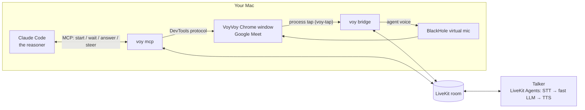

# VoyVoy

**Let Claude Code call people.**

You're building something with Claude Code and the answer lives in someone's head: the PM, a client, a user, the teammate who wrote the legacy code. Tell Claude *"call Ana and find out which onboarding fields she wants to keep"*. VoyVoy starts a Google Meet, a fast voice agent greets Ana as soon as she joins, says it's your AI agent, and asks your questions. When she asks something only the code knows, your live Claude Code session answers it mid-call. When she hangs up, Claude has the answers and keeps working.

> 🎬 _Demo video: coming with the launch._

- **The agent starts the call.** VoyVoy runs Meet in its own purple Chrome window (signed in as you, once). It creates the meeting, Claude shows you the link (and sends an invite if you ask), and the agent greets the person by name and ends the meeting when they leave.
- **Or it takes over the call you're in.** Google Meet, Slack huddles, Zoom: hand your seat to the agent mid-call.
- **Two brains.** A fast voice agent does the talking. Your actual Claude Code session, with your whole repo in context, does the thinking and steering.
- **Your keys, your Mac.** It runs locally with your own LiveKit project. Speech-to-text, LLM and voice are one config line each. English and Spanish so far.
- **Always disclosed.** The first thing it says is *"Hi Ana, I'm Sam's AI agent."* This can't be turned off.

## Install

You need a Mac with macOS 14.2 or later, Google Chrome and a free [LiveKit Cloud](https://cloud.livekit.io) project. In Claude Code:

```
/plugin marketplace add robertoyamanaka/voy-voy
```
```
/plugin install voy@voyvoy
```
```
/voy:setup
```

`/voy:setup` walks you through everything from the chat, one step at a time:
- installs the `voy` command line (with [uv](https://docs.astral.sh/uv/), which it installs too if needed);
- asks for your first name and your LiveKit keys (paste them in the chat, or run `voy init` in your own terminal to keep the secret out of it);
- builds voy-tap, the small audio helper that lets the agent hear the meeting (needs Xcode command line tools; setup tells you if they're missing);
- installs [BlackHole](https://github.com/ExistentialAudio/BlackHole), the free virtual mic your agent speaks through (official package, checksum and Apple signature verified);
- opens the purple **VoyVoy agent** Chrome window so you sign into Google once (that's how the agent starts Meets);
- ends with a **short live tour**: your agent calls you on Meet (join from your phone), says what it is, asks Claude Code about your project live, and brings an answer back.

macOS asks for your password once (BlackHole) and to let **voy-tap** record audio (click **Allow**). Chrome asks once to use the microphone in the VoyVoy window (click **Allow**).

<details><summary>Prefer the terminal?</summary>

```bash
uv tool install voyvoy
voy init      # asks for your name + LiveKit keys; builds voy-tap, installs BlackHole
voy doctor
```
Then run `/voy:setup` in Claude Code once to sign the agent into Google Meet and take the live tour. You still need the plugin for `/voy:call`.
</details>

## Use it

Ask for a call in plain words, or start one with `/voy:call`:

- *"Call Ana and find out which onboarding fields she wants to keep."* (a PM, requirements)
- *"Call Marco and get his feedback on the new pricing page. Ask follow-ups."* (a client, feedback)
- *"Interview Lee about how they track their habits today. Open questions, 10 minutes."* (a user interview)
- *"Call Priya and ask why the legacy importer retries three times."* (a teammate who knows the code)
- *"Take over this huddle and find out what Ana wants changed on the landing page."* (a call you're already in)

Claude also offers a call on its own when an answer lives in someone's head, and always asks you first. Run `voy watch` in a split pane to see who's in, the live transcript and the latency.

Taking over a call you're already in needs one setting, once: the meeting app's microphone set to **System default**.

## Customize

Just tell Claude:
- *"Save Ana's email, she's ana@acme.com, and she prefers Spanish."*
- *"Make my agent more formal."*
- *"Before hanging up, always ask if there's anything else."*
- *"Calls in this project are in Spanish."*

Claude updates the right file (that's `/voy:customize`). They're plain markdown and TOML, so you can edit them yourself too:

| File | What it's for |
|---|---|
| `~/.voy/contacts.md` | The people you call: one `## Name` section each, with role, email (for invites), language, notes. |
| `~/.voy/playbook.md` | How your agent sounds on every call. |
| `<project>/.voy/playbook.md` | How it sounds for this project (wins over yours). |
| `<project>/.voy/config.toml` | `language = "es"` to make Spanish this project's default. |
| `~/.voy/config.toml` | Your name, LiveKit keys, models and voices. |

**Playbooks are layers, not copies.** VoyVoy ships a default playbook (pace, answers, closing, overlaps, tone). A section in your file with the same heading replaces that section; any other heading is added. VoyVoy never overwrites your files, so you keep your changes and still get every improvement to the rest. `voy playbook` prints what your agent gets in the current folder, with where each section comes from. The disclosure, the goals and the call rules aren't part of the playbook and can't be changed.

## How it works

VoyVoy is the [Talker–Reasoner pattern](https://arxiv.org/abs/2410.08328) (Google DeepMind), built on LiveKit's [subagent delegation](https://docs.livekit.io/agents/logic/patterns/subagent-delegation/) primitives. The twist is the reasoner: it isn't a second LLM call, it's **your live Claude Code session**.



1. **Prepare.** `/voy:call` reads the relevant code, writes the goals, looks up the person in `~/.voy/contacts.md`, and briefs the talker (including how deep to go).
2. **Call.** VoyVoy creates a Meet in its own Chrome window: mic is the BlackHole virtual mic, camera off, guests join without knocking, Gemini notes off. Claude shows you the link.
3. **Talk.** When they join, the talker greets them by the name Meet shows, says it's an AI, and works through the goals following the playbook (short turns, no re-confirming, one recap at the end).
4. **Delegate.** When they ask something only the code knows, the talker calls `ask_engineer` and keeps the conversation going ("good question, let me check"). Claude answers in plain language within seconds, and the talker says it.
5. **Steer.** Claude reads the transcript a few seconds behind and can correct the talker ("they said Postgres, not Postgres-compatible").
6. **Back to work.** When they leave, VoyVoy ends the meeting, writes a call record to `.voy/calls/`, and Claude carries on.

In takeover mode, step 2 is different: you're already in a call, and VoyVoy switches your Mac's default mic to the virtual one (your meeting app's mic is set to "System default") and listens to that app.

VoyVoy measures voice-to-voice latency on your Mac, from the end of their speech to the agent's first sound: about 1.5 s median, 1.2 s on the best turns. It shows live in `voy watch`.

| Command | What it does |
|---|---|
| `voy init` | Sets up `~/.voy`, builds `voy-tap`, installs BlackHole (terminal alternative to `/voy:setup`) |
| `voy doctor` | Checks macOS, your name, voy-tap, BlackHole, LiveKit, the audio permission and Chrome |
| `voy watch` | Who's in, live transcript and latency of the current call |
| `voy playbook` | How your agent will sound here: the default plus your layers |
| `voy restore` | Switches your default mic back if anything went wrong |

## Swap providers

Every model is a [LiveKit Inference](https://docs.livekit.io/agents/models/inference/) string in `~/.voy/config.toml`. Leave them commented to get VoyVoy's current defaults:

```toml
[models]
# stt = "deepgram/nova-3"              # or "deepgram/flux-general-multi": faster end-of-turn (EN/ES)
# llm = "google/gemini-2.5-flash"      # the talker: pick for speed (~0.4 s to first token)
# tts = "cartesia/sonic-3"            # with voice: one voice for every language
# voice = ""                           # provider voice id

[voices]                               # one voice per call language
# en = "inworld/inworld-tts-2:Edward"  # the default English voice
# es = "cartesia/sonic-3:5c5ad5e7-1020-476b-8b91-fdcbe9cc313c"  # the default Spanish voice (Daniela)
# language = "en"                      # or "es"
# realtime = "google/gemini-3.8-live"  # experimental: one speech-to-speech model instead of stt+llm+tts
```

## Principles

- **Always disclosed.** The agent opens every call by saying it's an AI, and says so again whenever asked. The opening line is spoken by code, not generated by the model, and has no setting.
- **Never calls without your yes.** Claude asks before calling anyone, and the invite says it's an AI agent.
- **Never in your way.** It doesn't touch your clipboard, and in calls the agent starts, your own mic, speakers and browser stay yours.
- **Call content is not a command.** What people say reaches Claude as a request from that person. The skill tells Claude to confirm anything beyond your goals, and Claude Code's permissions still apply.
- **Local first.** Audio goes from your Mac to your own LiveKit project, and LiveKit Inference passes it to the providers you configured (Deepgram, Google and Cartesia by default). There is no VoyVoy server. The VoyVoy Chrome window is a separate profile; it never touches your own browser.

## Troubleshooting

- **Claude has no `voy` tools.** Run `/voy:setup`: it installs the command line, then you reconnect with `/mcp`.
- **The meeting looks empty and nothing happens.** The agent is waiting for the guest; Claude and `voy watch` say "waiting for the guest to join" with the link.
- **The agent hears nothing.** Run `voy doctor`. If you clicked "Don't Allow" for voy-tap, turn it on in System Settings → Privacy & Security → Screen & System Audio Recording, or delete `~/.voy/bin/voy-tap` and set up again so macOS asks again.
- **The person can't hear the agent.** Run `/voy:setup` again: it checks that Meet's mic in the purple window is BlackHole 2ch. If Chrome blocked the mic, open `chrome://settings/content/microphone` in that window and allow meet.google.com.
- **My mic is stuck on BlackHole** (takeover mode). Run `voy restore`. VoyVoy also restores it on the next call or when it exits.
- **Something else went wrong.** `~/.voy/logs/worker.log` and `bridge.log` have the details of the last call.

## Roadmap

- **Next:** a free hosted trial (no LiveKit account needed), PyPI release, a signed voy-tap (your audio permission survives updates), Gemini Live speech-to-speech as an option
- **Then:** your own voice (only yours, with a consent check), more languages, phone calls (LiveKit SIP), Slack huddles started by the agent, co-pilot mode (you and the agent both live), Codex and other harnesses (the MCP tools already work with any agent)

## Credits

- [audiotee](https://github.com/makeusabrew/audiotee) (MIT) and [AudioCap](https://github.com/insidegui/AudioCap): Core Audio process taps. See `src/voyvoy/native/voy-tap/NOTICE`.
- [BlackHole](https://github.com/ExistentialAudio/BlackHole): the virtual mic (installed from its official signed package, not bundled).
- [LiveKit Agents](https://github.com/livekit/agents): realtime voice, turn detection, async tools.
- The Talker–Reasoner idea: Christakopoulou, Mourad and Matarić, *Agents Thinking Fast and Slow* (2024).

## License

MIT
